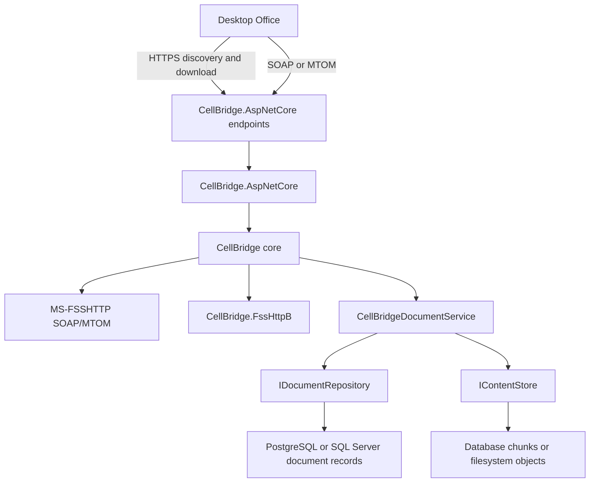

# Architecture

Document persistence uses small current records, immutable protocol elements,
current object bindings and versioned mapping intervals. The
[Office storage design](office-storage-design.md),
[operation catalog](office-operation-catalog.md) and
[cost model](office-operation-costs.md) explain the requirements and tradeoffs.

CellBridge implements the Office file synchronization protocols in reusable
.NET libraries. WebDemo provides a development environment;
[interoperability coverage](interoperability.md) describes the tested client
behavior and unsupported operations.

## Request flow

The `CellBridge` package handles `/_vti_bin/cellstorage.svc`, document execution
and storage contracts. `CellBridge.AspNetCore` owns HTTP routing, authentication
integration and dependency registration. Cell subrequests carry MS-FSSHTTPB
requests inline as base64 or in MTOM attachments.
`CellBridgeRequestProcessor` executes parsed SOAP requests for the mapped endpoint
and direct callers. It resolves document identity and sends binary Cell requests
to `CellBridgeDocumentService.ExecuteAsync`. Direct binary integrations use that
same service. The service validates the request, selects each operation's target
partition and runs the operations in request order. Internal handlers prepare
file and metadata graphs and build query responses. InMemory, PostgreSQL and SQL
Server use this execution path.

The endpoint serializes each operation's protocol response. HTTP 200 alone does
not indicate save success.
See [protocol scope](protocol-version-decision.md).

Authentication runs before parsing. The sample supplies PostgreSQL Identity
accounts, MS-OFBA challenges and shared cookie protection keys. Each operation
checks the caller's stable subject against the resolved document's ownership
and grants. Sessions, leases and receipts retain their authenticated owner.
See [authentication and permissions](authentication.md).

## Libraries and executables

The eleven shipping packages are `CellBridge`, `CellBridge.FssHttpB`,
`CellBridge.AspNetCore`, `CellBridge.Storage.InMemory`,
`CellBridge.Storage.PostgreSql`, `CellBridge.Storage.SqlServer`,
`CellBridge.Storage.FileSystem`, `CellBridge.Lists`,
`CellBridge.Lists.PostgreSql`, `CellBridge.Lists.SqlServer` and
`CellBridge.Lists.AspNetCore`.

| Project | Responsibility |
| --- | --- |
| `CellBridge` | SOAP/MTOM parsing, document execution, storage contracts, document state and persistence codecs |
| `CellBridge.FssHttpB` | Binary framing, manifests, graph data and synchronization messages |
| `CellBridge.Storage.PostgreSql` | EF Core document persistence, explicit migrations, per-document coordination and chunked content |
| `CellBridge.Storage.SqlServer` | Independent EF Core document persistence, explicit migrations, coordinated state and chunked content |
| `CellBridge.Storage.FileSystem` | Immutable binary content with file and directory flushes |
| `CellBridge.Storage.InMemory` | Volatile provider for development and tests |
| `CellBridge.AspNetCore` | HTTP endpoints, login integration and dependency registration |
| `CellBridge.Lists` | Typed workspace lists, schema validation, merge comparisons and bounded queries |
| `CellBridge.Lists.PostgreSql` | Independent EF Core list persistence and migrations, JSONB records, workspace isolation and grants |
| `CellBridge.Lists.SqlServer` | List persistence, migrations, SQL queries, workspace authorization, views and audit |
| `CellBridge.Lists.AspNetCore` | Opt-in list APIs, protected paging, CSV/XLSX and read-only OData subset |
| `CellBridge.WebDemo` | Non-packable development host, Razor Pages, package generation and catalog APIs |
| `CellBridge.Authentication` | Development Identity account store and key protection |
| `tools/CellBridge.Admin` | Operator account provisioning, explicit file imports and document permission updates |
| `tools/CellBridge.Storage.Setup` | Current-schema initialization and quiescent object maintenance |
| `src/CellBridge.AppHost/CellBridge.AppHost.csproj` | PostgreSQL, schema initialization, WebDemo and optional capture proxy |

The binary library is independent of ASP.NET Core and storage. Storage providers
depend on `CellBridge` and do not depend on `CellBridge.AspNetCore`. One AppHost
starts WebDemo, PostgreSQL, initialization and optional capture.

The optional [list engine](lists.md) uses separate database tables, setup and
runtime credentials. Hosts supply validated identities and customer workspaces.
Its APIs and state are independent of Office document synchronization.
PostgreSQL and SQL Server use the same document and Lists operations. Each
provider owns its mappings, migrations, security settings and SQL. Required
database locking stays enabled. Document and Lists packages have independent
storage dependencies.

SQL Server consumers explicitly call the document or Lists migrator with setup
credentials before starting stores or engines with restricted runtime
credentials. Registration and requests never apply migrations. See
[document setup](storage-providers.md) and [Lists setup](lists.md#sql-server-setup-and-runtime).

## Document identity and partitions

A document has a stable resource ID and a normalized path key. A supplied
resource ID takes precedence over a URL; an unknown ID returns an explicit
lookup failure. Lookup does not create a document or redirect to a matching path.

File contents, application metadata and the editors table have independent
partition identities, serials and synchronization knowledge. File saves merge
keywise storage-index updates and resolve explicit revision/base references through
`IndexedDocumentGraph`. Current object bindings accelerate the latest revision.
Historical package reads use binding checkpoints and bounded change replay.
Reconstruction follows graph references rather than choosing a binary object by size.

## Saving a document

The service prepares changed canonical elements and resolved object bindings before
taking a document lock. It reconstructs the selected package into an exclusive
temporary file, checks ZIP members against the expanded-byte limit, and records
its exact length and digest. It deletes the temporary file when preparation ends.
It stores new canonical elements and the protocol acknowledgement durably. It does
not store another complete downloadable package for every change.

Publication then locks the affected document row, reads database time, and checks
current permission, mapping expectations and lease authority. One transaction
updates the current roots, changed bindings, application revision, receipt,
per-document counters and any external delivery intent. It never serializes the
complete retained history during an ordinary save. PostgreSQL uses row locks and
SQL Server uses update row locks. Unique path constraints coordinate competing
names. Different documents can publish independently.

Provider-wide byte and document-count quotas and their reservation buckets were
removed. Per-document and per-request limits remain. Database migrations preserve
the old developer data and convert it to the normalized records. Legacy aggregate
codecs remain only for reading these migration and recovery inputs.

Cancellation after an established save stops remaining operations and returns an
incomplete execution with `IsCancelled` and known file receipts. The SOAP
processor preserves that result. Cancellation before acceptance can throw;
completed saves are never rolled back. See [accepted saves](package-integration.md#accepted-saves-and-external-content)
for uncertain commit outcomes and HTTP delivery limits.

Downloads take content and headers from one snapshot. Receipts identify duplicate
saves; per-document limits reject excessive growth before selecting a new revision.
Retained revisions and protocol ancestry keep their canonical elements available.
Rejected candidates can leave unreferenced physical objects. Collection requires
readers and writers to be stopped; ordinary operations take no collection gate.

[Storage providers](storage-providers.md) explains publication, retries, maintenance
and provider contracts. The [protocol guide](protocol-version-decision.md#synchronization-knowledge)
explains changed-part selection, graph retention and materialization constraints.

MTOM responses stream one prepared message with matching capture bytes and exact
content length. Incoming requests and retained graph payloads still occupy memory.
See [response serialization](protocol-version-decision.md#response-serialization)
for buffer ownership and XML precedence.
